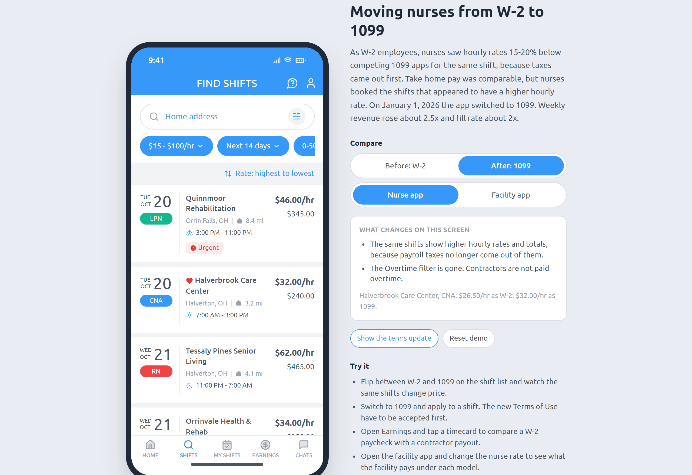
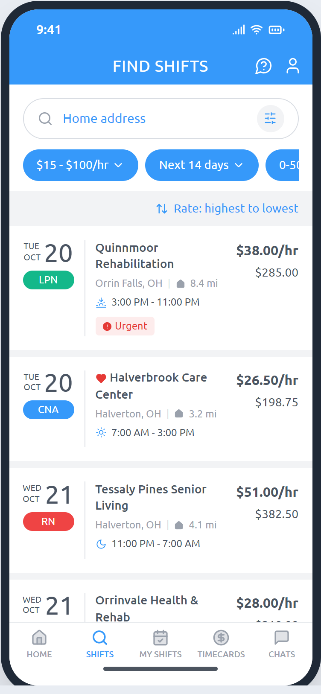
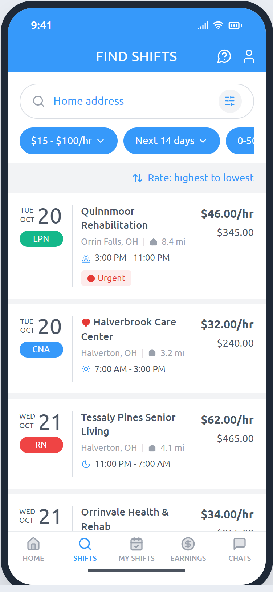
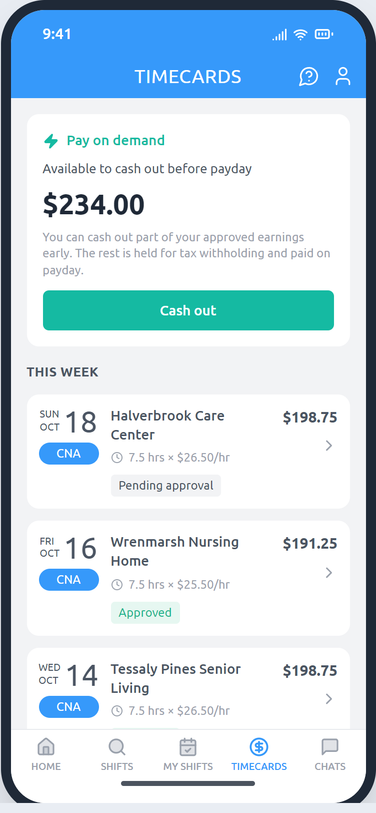
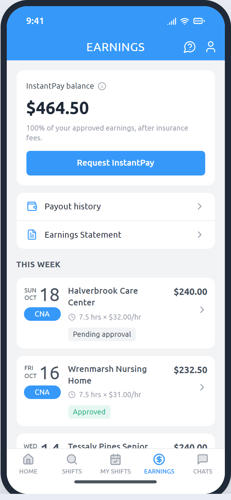
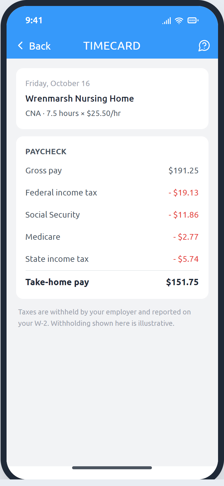
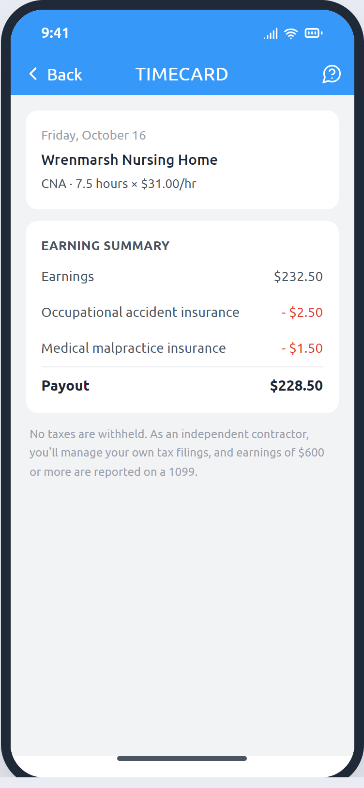
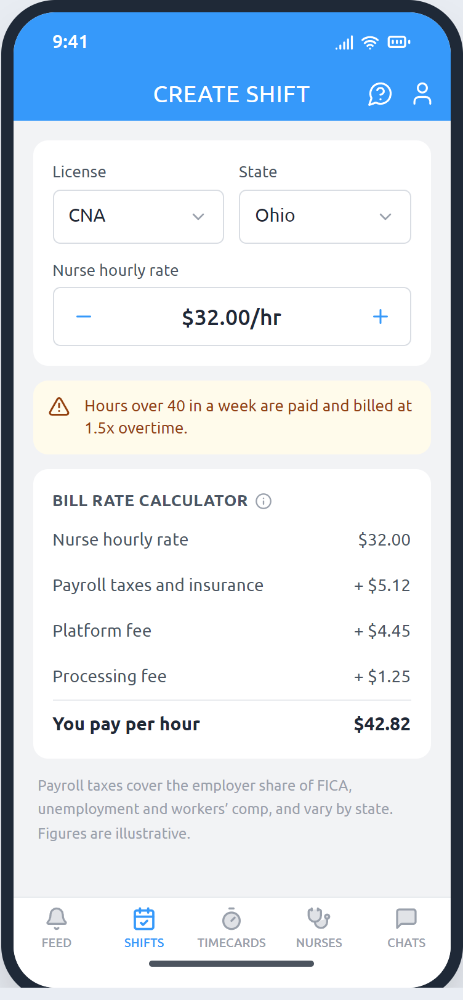
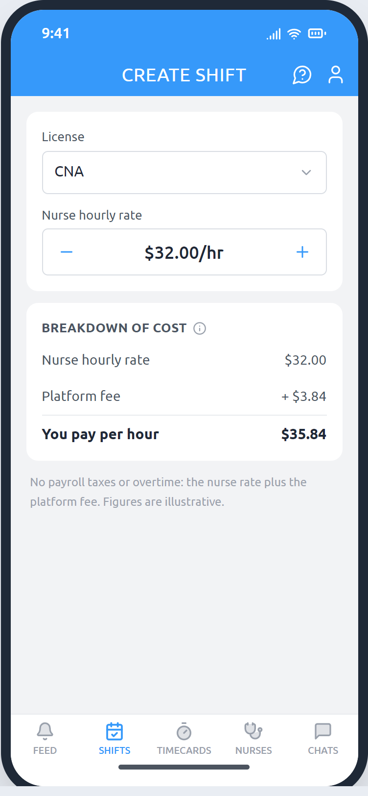

# W-2 to 1099: changing how a nurse staffing app employs nurses

An interactive before-and-after recreation of a change I led as the product manager on a nurse staffing app: moving nurses from W-2 employment to 1099 independent contractors. The [case study](docs/CASE_STUDY.md) behind it is in this repo too.

**[Try the live prototype](https://josephfanpm.github.io/eshyft-1099/)**



This is an independent portfolio project, not an official app. The copy follows the shipped app and Figma designs, but every facility, rate and tax figure is illustrative, and the company's branding is left out.

## The short version

Per diem nurses keep two or three staffing apps on their phone and book whichever shift pays best on the day they're free. The biggest competitors treat nurses as 1099 contractors. Ours employed them as W-2 employees, so taxes came out of the rate first, and our hourly rates looked 15–20% lower for comparable work. After taxes the pay was comparable, but nurses booked the shifts that appeared to have a higher hourly rate. In rate experiments, a boost of as little as $1 an hour increased confirmed shifts by more than 10%.

I pushed for the switch to 1099, even though some of our largest clients preferred W-2 and some legislation had favored it. Leadership agreed. Converting the apps and legal language took about three months, and it launched on January 1, 2026. Since launch, weekly revenue is up about 2.5x and fill rate has roughly doubled. The [case study](docs/CASE_STUDY.md) covers why ESHYFT started as a W-2 employer, with a PESTLE review and sources, plus the decision, what changed and what I learned.

## What changed

| | Before: W-2 | After: 1099 |
|---|---|---|
| Shift list |  |  |
| Earnings |  |  |
| Pay stub |  |  |
| Facility calculator |  |  |

## What you can do in the prototype

- Switch between **Before: W-2** and **After: 1099** from the panel beside the phone. The panel lists what changed on whichever screen you're on.
- On the shift list, the same shifts post higher rates under 1099, and the Overtime filter disappears.
- Switch to 1099 and the app shows the terms update every existing nurse saw. Close it and apply to a shift: you have to accept the new Terms of Use first.
- Open Timecards (renamed Earnings under 1099). W-2 nurses could cash out only part of their approved pay early; contractors can cash out all of it. Tap a timecard to compare a W-2 paycheck with a contractor payout.
- Switch to the facility app and change the nurse rate. Under W-2 the bill rate adds payroll taxes and a processing fee; under 1099 it's the nurse rate plus a platform fee.
- Reset the demo from the panel to start over.

## Running it locally

```bash
npm install
npm run dev     # http://localhost:5173
npm test        # pay and bill-rate logic tests
npm run build
```

Built with React 19, TypeScript, Tailwind CSS v4 and Vite. The pay, cash-out and bill-rate math lives in [`src/data.ts`](src/data.ts) with tests beside it, and the screens are in [`src/`](src).
