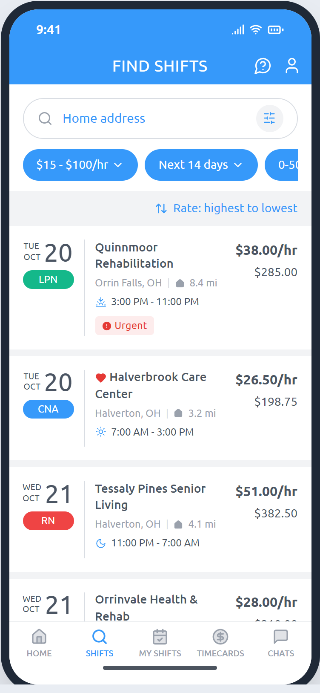
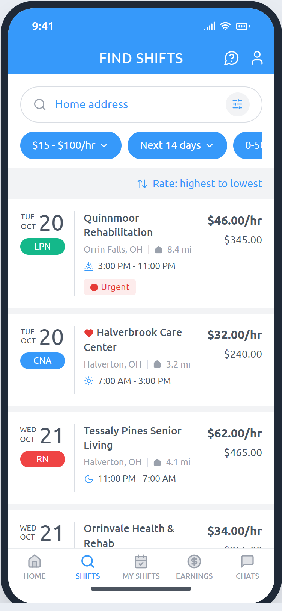
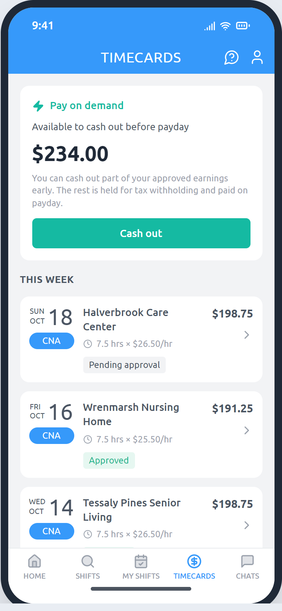
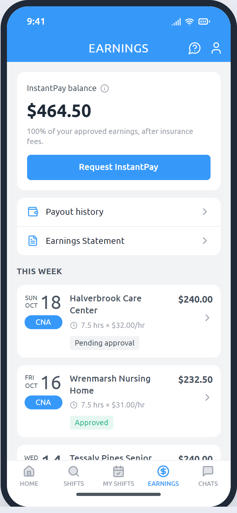
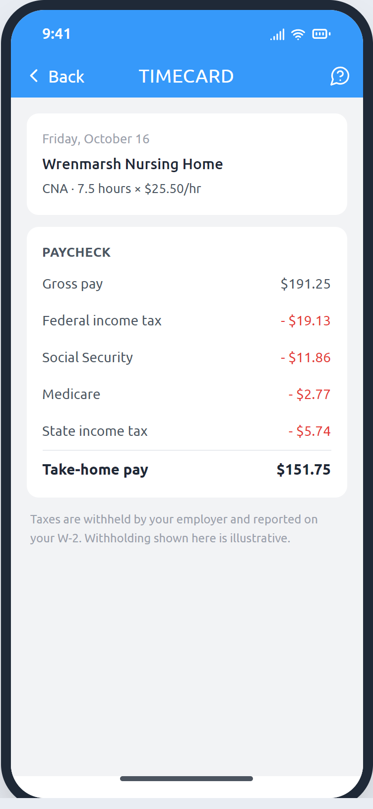
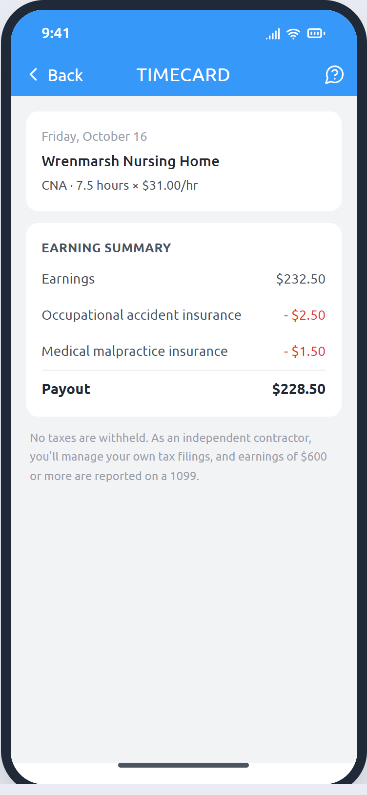
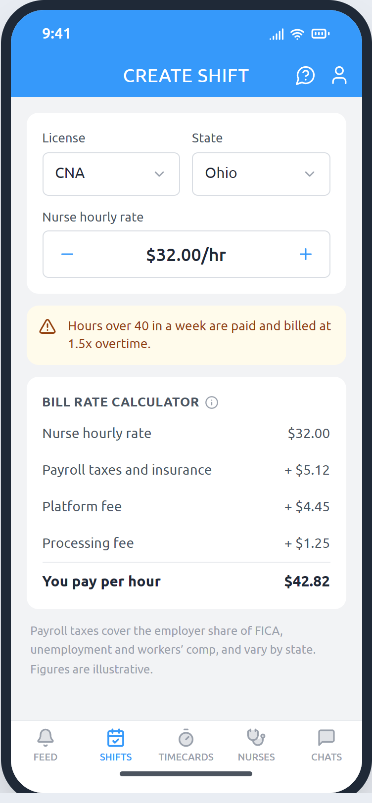
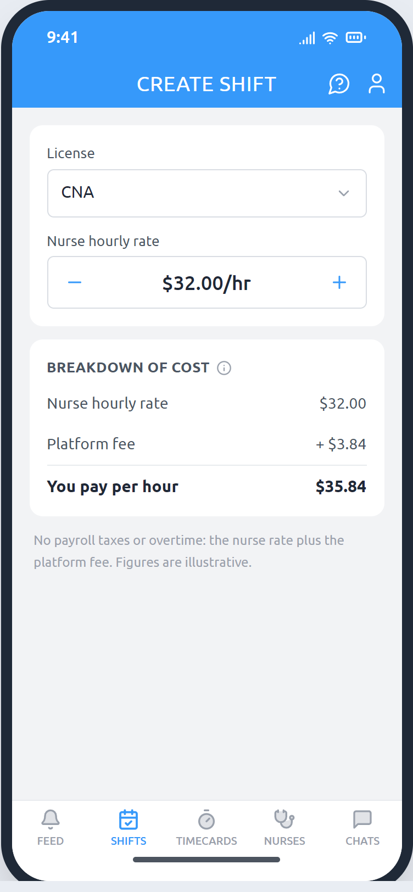
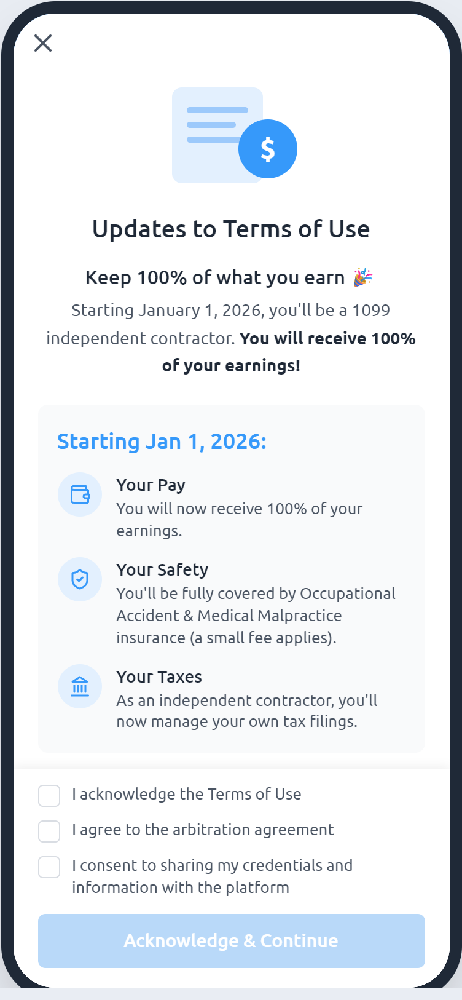

# Case study: moving nurses from W-2 to 1099

I was the product manager who proposed and led this change at ESHYFT, a marketplace where nursing homes post per diem shifts and CNAs, LPNs and RNs pick them up. On January 1, 2026, ESHYFT stopped employing nurses as W-2 employees and started working with them as 1099 independent contractors. The [interactive prototype](https://josephfanpm.github.io/eshyft-1099/) in this repo is my own before-and-after recreation of what changed in the apps, built for this portfolio. It uses made-up facilities and illustrative rates and tax figures, and leaves out ESHYFT's branding.

## Why ESHYFT started as a W-2 employer

ESHYFT chose to employ its nurses because its first facility customers preferred it, and because the legal climate in several key states leaned toward treating healthcare workers as employees. A PESTLE review of the conditions at the time explains the choice, and also shows how much those conditions had shifted by 2025.

| Factor | When ESHYFT chose W-2 | By 2025 |
|---|---|---|
| **Political** | Regulators were tightening nursing home staffing. CMS finalized a minimum staffing rule for nursing homes in 2024, which raised demand for nurse hours. | The rule was vacated by a federal court in April 2025, put under a 10-year moratorium by Congress, and repealed by CMS in December 2025.[^cms] |
| **Economic** | Post-pandemic staffing shortages made facilities willing to pay for reliable staff. Under W-2, the facility's bill rate also had to cover the employer's payroll taxes, unemployment insurance and workers' comp. | Nursing homes added jobs and cut agency use sharply, so facilities became more price-sensitive.[^ahca] Competing 1099 apps could post higher nurse rates from the same facility budget. |
| **Social** | Facility customers, especially larger operators, were more comfortable with employed staff. | Nurses kept asking for flexibility. In one industry survey, 72% of independent contract nurses also held a full- or part-time job.[^nursa] Those nurses compare posted rates across two or three apps. |
| **Technological** | Shift marketplaces were new. | App-based booking and instant pay had become the norm across nurse staffing apps. |
| **Legal** | Several large states apply a strict "ABC test" that makes contractor status hard to defend for nurses, including California under AB5,[^ab5] New Jersey and Massachusetts.[^ma] The federal Department of Labor's 2024 rule also leaned toward employee status,[^dol24] and courts and plaintiffs were pursuing nurse misclassification, including suits against facilities that used gig nurses.[^snn] | The Department of Labor stopped enforcing its 2024 rule in May 2025.[^fab] Colorado, Tennessee, Iowa and Utah passed laws that explicitly recognize healthcare platforms whose nurses work as contractors.[^ainow] Risk didn't disappear: a federal appeals court upheld a nurse misclassification finding in July 2025.[^steadfast] |
| **Environmental** | No material factor either way. | No material factor either way. |

The legal picture was never one-sided. The point is that the reasons for choosing W-2 were strongest early on, and by 2025 the market, the regulators and the competition had all moved.

## The problem

Our nurses booked shifts the way most per diem nurses do: they opened two or three staffing apps and took the shift that paid best on the day they were free. The largest competing apps, including ShiftKey, Clipboard Health, CareRev and Nursa, all treat nurses as independent contractors.[^comp]

That made our rates look worse. Taxes came out of a W-2 rate before the nurse ever saw it, so the hourly rate and estimated earnings in our app typically looked 15–20% lower than a competitor's for comparable work. After taxes, pay on the two kinds of platform was comparable. But nurses compare the rates they see across apps, and they booked the shifts that appeared to have a higher hourly rate.

We had evidence that this gap mattered. In experiments on nurse rates, boosting some shifts by as little as $1 an hour increased confirmed shifts by more than 10%. If $1 moved behavior that much, a 15–20% gap in the posted rate was costing us a large share of the shifts nurses would otherwise book.

Competitive analysis, those rate experiments and conversations with nurses all pointed to the same conclusion: the most important thing holding back our fill rate wasn't a missing feature. It was how we employed nurses.

## The decision

Switching was not an easy call. Some legislation had favored W-2, as the PESTLE review shows, and some of our largest facility clients, each a significant share of revenue, had chosen us partly because we were a W-2 employer. Losing even one of them would hurt.

I made the case to leadership to switch to 1099 anyway. Nurses were choosing competitors because of the posted rate. Facilities would pay the same or less for the same nurse rate, because payroll taxes would no longer be part of the bill rate. And the regulatory trend had turned in favor of contractor platforms. Leadership agreed.

The goals:

1. Make our posted rates competitive with 1099 apps, without raising what facilities pay.
2. Increase fill rate and revenue by winning back the shifts nurses were booking elsewhere.
3. Move every eligible nurse and facility over on a single date, without interrupting shifts or payouts.

## What we built

Converting the apps and our legal language took about three months, from kickoff in late September 2025 to launch on January 1, 2026. The work touched every product:

- **Classification.** Every nurse, facility and shift got an employment type. Shifts starting on or after January 1 at eligible facilities became 1099, and a small number of states stayed W-2. A nurse could only see and work one type of shift, so nobody ended up with both a W-2 and a 1099 in the same year.
- **Terms and consent.** Every existing nurse saw a full-screen notice explaining the change and had to accept new Terms of Use before they could apply, book or clock in on a contractor shift. New nurses accepted them at sign-up.
- **Rates and pay.** Posted rates no longer had taxes withheld. Contractors pay two small per-shift insurance fees, for occupational accident and medical malpractice cover, instead of having payroll taxes taken out.
- **Payouts.** We moved contractors to a new payout system. W-2 nurses could cash out only part of their approved pay early, because the rest was held for withholding. Contractors can cash out all of it.
- **Nurse app language.** We reworded the app for contractors: Timecards became Earnings, "work state" became "license state," employee-only features such as overtime and the I-9 step were removed, and the referral bonus lost its supplemental-wage tax note.
- **Facility apps.** The bill rate calculator dropped payroll taxes, the state picker and the processing fee: the bill rate became the nurse rate plus a platform fee. Overtime settings and warnings were removed.
- **Admin and operations.** Internal tools gained employment-type filters, contractor payouts and a record of who had accepted the new terms.

### Before and after

| Screen | Before: W-2 | After: 1099 |
|---|---|---|
| Shift list |  |  |
| Earnings |  |  |
| Pay stub |  |  |
| Facility calculator |  |  |

Every existing nurse saw this notice when they opened the app after the switch:

## Managing the risks

- **Large clients.** At the same nurse rate, facilities pay less per hour, because payroll taxes are no longer part of the bill rate.
- **Legal exposure.** Legal counsel wrote the new Terms of Use and privacy policy, and we kept W-2 where state law made contractor status riskier.
- **Mixed classification.** We blocked any nurse from working both W-2 and 1099 shifts, which would have created messy payroll and tax situations.
- **Cutover.** We switched everyone on a single date and kept W-2 and 1099 timecards side by side briefly, so December shifts were paid out under the old model.

## Impact

It paid off.

- **Weekly revenue is up about 2.5x** since launch.
- **Fill rate on our platform roughly doubled.**

Nurses now see rates that compete directly with the other apps on their phone, and facilities get more of their shifts filled.

## What I learned

High-impact work doesn't have to be a flashy new feature. This was one of the most valuable things I worked on, and it changed no screen layouts. It came from three ordinary product habits: looking hard at competitors, running experiments, and talking with nurses and facilities. The rate experiments showed how much a small difference in the posted hourly rate mattered. Competitive analysis showed why our rates looked lower. Talking with customers showed that the problem wasn't what nurses actually took home, but which shift appeared to pay more per hour when they compared apps.

It also taught me to revisit decisions that made sense when they were made. Choosing W-2 was right for ESHYFT's first customers and the legal climate at the time. Reviewing those conditions again with a PESTLE analysis showed they had changed.

## What I'd do next

- Help contractors with taxes in the app: collect W-9s, deliver 1099s electronically and show how much to set aside from each payout. Many nurses are filing as contractors for the first time.
- Test showing an estimated take-home amount next to the posted rate, so nurses can compare what they keep across apps and not just the headline rate.
- Track state legislation on healthcare worker platforms, so the states that stayed W-2 can switch when the law allows, and so we can respond quickly in states that tighten.

[^cms]: American Hospital Association, ["CMS repeals minimum staffing requirements for skilled nursing, long-term care facilities"](https://www.aha.org/news/headline/2025-12-02-cms-repeals-minimum-staffing-requirements-skilled-nursing-long-term-care-facilities), December 2, 2025.
[^ahca]: Skilled Nursing News, ["AHCA: Nursing homes added 40,700 jobs in 2025 as turnover, agency use declined"](https://skillednursingnews.com/2026/01/ahca-nursing-homes-added-40700-jobs-in-2025-as-turnover-agency-use-declined/), January 2026.
[^nursa]: Nursa via Business Wire, ["Nursa Survey Finds 72% of Independent Contract Nurses Also Hold Full- or Part-Time Jobs"](https://www.businesswire.com/news/home/20241204377563/en/Nursa-Survey-Finds-72-of-Independent-Contract-Nurses-Also-Hold-Full--or-Part-Time-Jobs), December 4, 2024.
[^ab5]: Hooper Lundy, ["California Assembly Bill 5 and Health Care Workers"](https://hooperlundy.com/california-assembly-bill-5-and-health-care-workers/), 2019. AB5's healthcare exemption covers physicians and a few other professions, not nurses or CNAs.
[^ma]: Massachusetts Attorney General, ["An Advisory from the Attorney General's Fair Labor Division on M.G.L. c. 149, s. 148B"](https://www.mass.gov/doc/attorney-generals-advisory-on-the-independent-contractor-law/download). New Jersey applies the same test under its wage and unemployment laws; see [NJDOL, April 28, 2025](https://www.nj.gov/labor/lwdhome/press/2025/20250428_ABC.shtml).
[^dol24]: Legal 500 / Davis+Gilbert, ["US Department of Labor Publishes Final Rule on Independent Contractor Status"](https://www.legal500.com/intelligence/united-states/employment-and-hr/us-department-of-labor-publishes-final-rule-on-independent-contractor-status), 2024. The rule took effect March 11, 2024.
[^snn]: Skilled Nursing News, ["Nursing home operators targeted in increasing number of litigation tied to 1099 misclassification"](https://skillednursingnews.com/2024/03/nursing-home-operators-targeted-in-increasing-number-of-litigation-tied-to-1099-misclassification/), March 2024.
[^fab]: U.S. Department of Labor, [Field Assistance Bulletin No. 2025-1](https://www.dol.gov/sites/dolgov/files/WHD/fab/fab2025-1.pdf), May 1, 2025.
[^ainow]: AI Now Institute, ["Uber for Nursing Part II, Appendix A: Table of State Policies"](https://ainowinstitute.org/wp-content/uploads/2026/04/Uber-For-Nursing-Part-II-Appendix-A-Table-of-State-Policies.pdf), April 2026. See also Colorado [SB22-210](https://leg.colorado.gov/bills/SB22-210) and Utah [SB228](https://le.utah.gov/~2025/bills/static/SB0228.html).
[^steadfast]: Constangy, ["Fourth Circuit's Steadfast ruling clarifies independent contractor status"](https://www.constangy.com/newsroom/newsletters/fourth-circuits-steadfast-ruling-clarifies-independent-contractor-status), July 23, 2025.
[^comp]: Each company's own terms or help pages: [ShiftKey](https://app.shiftkey.com/tos-provider), [Clipboard Health](https://www.clipboard.com/for-workers), [CareRev](https://carerev.com/professionals/faq), [Nursa](https://community.nursa.com/help-center/clinician/get-paid/tax-info/1099-guide/).
